# Download Workflow

This document details the end-to-end workflow when a client requests a video download.

## Workflow Diagram

```mermaid
flowchart LR
    Client["Client POST /download"] -->|JSON: url, pages| API["Flask API"]
    API -->|validates & routes| Celery["Celery Worker"]
    Celery -->|headless Chrome| Scrape["Scrape page for videos"]
    Scrape -->|Video list| Download["Download via yt-dlp"]
    Download -->|≥ 20 min| Save["Save to ./videos/"]
    Download -->|< 20 min| Skip["Skip video"]
    Save --> MorePages{"More pages?"}
    Skip --> MorePages
    MorePages -->|yes| Scrape
    MorePages -->|no| Done["Close browser & done"]

    classDef api fill:#e1f5fe,stroke:#01579b,stroke-width:2px
    classDef worker fill:#e8f5e9,stroke:#1b5e20,stroke-width:2px
    classDef scrape fill:#fff3e0,stroke:#e65100,stroke-width:2px
    classDef download fill:#fce4ec,stroke:#880e4f,stroke-width:2px
    classDef decision fill:#f3e5f5,stroke:#4a148c,stroke-width:2px,stroke-dasharray:5,5
    classDef endNode fill:#fafafa,stroke:#616161,stroke-width:2px

    class API api
    class Celery worker
    class Scrape scrape
    class Download,Save,Skip download
    class MorePages decision
    class Done endNode
```



---

## Step-by-Step Flow

### 1. API Request

A client sends a `POST /download` request with JSON body:

```json
{
  "url": "https://example.com/videos/my-series",
  "parent_directory": "Category",
  "number_of_pages": 3
}
```

- **`url`** (required): The website URL to scrape for videos.
- **`parent_directory`** (optional): Top-level folder name for organizing downloads.
- **`number_of_pages`** (optional, default 1): Number of pages to scrape, following "next page" links.

### 2. Routing

`RouteService.route_url()` dispatches the request. Currently it uses `handle_free()`, which directly queues a Celery task (`run_browser.delay()`). Two alternative paths exist:

- **`handle_free`** — Direct local scraping via Celery + Selenium.
- **`handle_hits`** — Delegates URL processing to an external service (`URL_PROCESSOR`), then polls for results via `MonitorService`.

### 3. Celery Task (`run_browser`)

The `page_nav_service.run_browser` Celery task:

1. Launches a headless Chrome browser via `ChromeDriver`.
2. Creates a download directory via `DirectoryService`.
3. For each page (1 to `number_of_pages`):
   - Scrapes video elements using `ScraperService` (CSS selector: `div.item-info > a.thumb_title`).
   - Downloads each video via `DownloaderService`.
   - Clicks the "next page" link (`li.next a`) and repeats.
4. Closes the browser.

### 4. Scraping

`ScraperService.scrape_multiple_videos()` extracts video data from the current page:

- Finds all `div.item-info` elements.
- For each, extracts the `href` (link) and `title` attribute from `a.thumb_title`.
- Returns a list of `Video` objects.

### 5. Downloading

`DownloaderService.download_videos()` uses yt-dlp to download each video:

- Loads options from `yt_dlp.json` (format: best 720p+ MP4, retries, error handling).
- Filters out videos shorter than **20 minutes** via `skip_short_videos()`.
- Saves files to the directory created by `DirectoryService`.
- Tracks downloaded videos in `/app/log/downloaded_videos.txt` (archive file).

### 6. Video Title Formatting

`Video.get_videos_title()` reformats video titles by parsing hyphen-separated parts:

- For "hits" URLs: extracts names from the end of the title string.
- For other URLs: extracts names from the beginning.
- Output format: `[Name1, Name2]Title`
